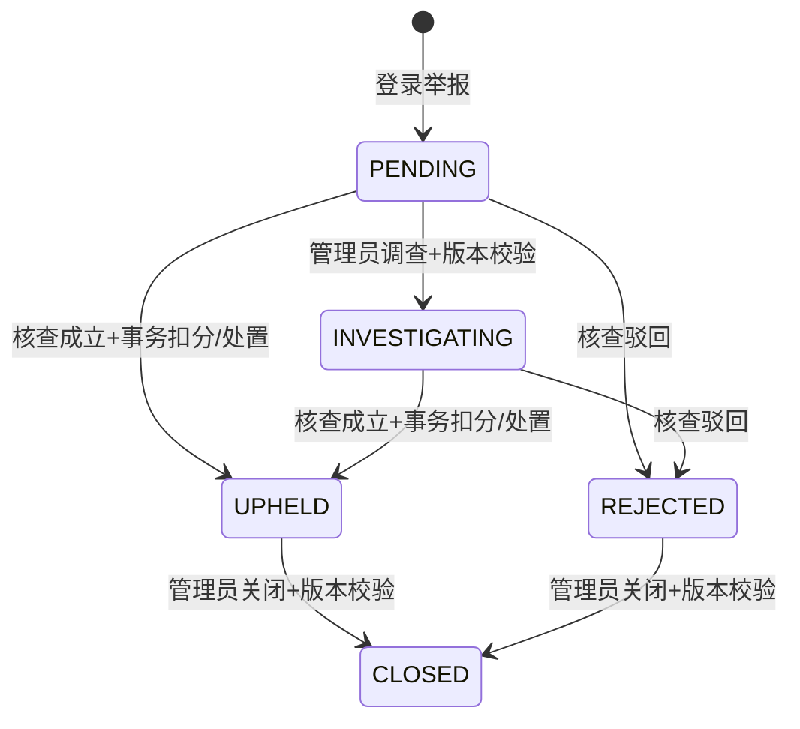

# C 模块设计与演示

实现日期：2026-10-29。接口明细以生成的 [OpenAPI](openapi.json) 为准；与 B 的接入以 [C→B交接](handoff/c-to-b.md) 为准。

## 数据与业务

迁移 `004_c_community.sql` 新增 `conversation/chat_message/favorite/report/platform_rule`，为商品增加独立监管冻结标志。会话唯一键 `(product_id,buyer_id,seller_id)`；消息 `(conversation_id,sender_id,client_message_id)`；收藏 `(user_id,product_id)`。

会话只能由商品买家与卖家参与；未实名认证的登录用户也能咨询，与冻结契约一致。创建时拒绝自聊、不可售商品和禁用账号。每次读/写检查参与者，管理员身份不提供全量聊天访问。消息保留在数据库，最多1000 Unicode字符，NFKC归一化并过滤联系方式、引流、违禁词。

消息重试必须沿用 `clientMessageId`；同键同内容返回原消息，同键不同内容409。发消息先锁发送方限频，再锁会话，防止同一会话的已提交消息跨游标丢失。增量接口取51条探测更多，最多返回50条，字符串 `nextAfterId` 避免bigint精度丢失。客户端有下一批时立即续读，否则前台每3秒轮询，隐藏/卸载停止定时器并丢弃在途结果。发送响应不推进读取游标，避免跳过并发消息。

收藏新增/取消幂等，收藏列表保留不可用商品，并标明不可用，不跳转到已下架详情。举报记录只向举报人和管理员返回；普通用户提交的 reporterId 无效，后端使用当前认证身份。已有待处理工单不重复创建。可直接处理待处理/调查中工单；调查和关闭动作携带版本，成立/驳回通过行锁和终态检查防止重复。成立、处罚、B信誉事件、操作日志共用一个事务，失败全部回滚。

管理员可在指定举报范围内查阅相关会话：只包括举报人与被举报人之间、且商品举报还须匹配商品的会话；每次读取消息写审计。管理员不得处理或查阅与自己有关的工单。不提供所有会话后台接口。当前举报证据列表最多100个会话，消息可继续分页；交易纠纷证据授权待B提供订单依据后追加。

## 监管和公共规则

统一 `pages/admin/admin` 工作台保留 A 的认证及商品审核，同时增加举报、账号、冻结、分类、规则和脱敏日志。A 审核仍传列表中的 `expectedVersion`，失败后刷新列表，不能自动拿新版本静默重试。商品解冻和平台规则更新也校验版本。

禁用用户删除其服务端登录会话，恢复账号不恢复旧令牌，需重新登录。禁止通过账号接口赋值role或信誉，禁止处置管理员。分类只能新增、改名、启停；保留已引用记录。日志只返回固定字段，不返回可能含身份文本的details。

| 平台规则 | 默认 | 实际使用位置 |
|---|---|---|
| `blocked_keywords` | 违禁品和引流关键词列表 | 消息及商品保存 |
| `messages_per_minute` | 30 | 发送方行锁内跨会话限频 |
| `reports_per_minute` | 5 | 举报人行锁内限频 |
| `publish_per_minute` | 5 | A发布事务中的卖家行锁内限频 |
| `publish_min_credit` | 60 | A发布/编辑/重新提交的卖家校验 |

规则从数据库读取，修改后立即生效；配置写入仅允许已知键及合法范围。联系方式/引流硬性过滤和 A 的基础内容校验保留，平台关键词用于补充封禁。

## 课堂演示步骤

先运行 `scripts/start.ps1`，微信开发者工具导入 `miniprogram`。用本机 `.env` 中的演示密码，不在讲解中展示密码/密钥。

1. 买家登录→商品详情→咨询卖家，发送“请问还在吗”；卖家登录→我的咨询→回复。回到买家会话观察轮询，离开页面后停止轮询。
2. 发送手机号/外链，展示拦截；第三个账号猜会话ID，接口返回404。
3. 详情收藏→我的收藏；卖家下架后展示“商品已不可用”，取消收藏可重复操作。
4. 买家举报商品，查看“我的举报”；管理员进入统一工作台、开始调查、查看本举报相关凭证。
5. 无 B 服务时尝试“成立并冻结”，展示明确503提示、工单仍待处理/调查中，商品和信誉未变；可独立演示证据不足驳回及关闭。
6. B正式接入后，成立举报→商品冻结、信誉减5；重复处理返回409。卖家重新提交/编辑失败，解冻后仍需重新审核。交易锁定商品解冻不释放订单锁。
7. 管理员演示分类停用/恢复、规则更新、账号禁用/恢复、脱敏操作日志。A原有学生认证及商品审核入口仍在；用旧版本提交展示冲突刷新。

自动化证据见 [C测试记录](member-c-test-report.md)。本机未执行微信原生模拟器/真机的上述新页面交互，不能将脚本说明计作人工验收。
