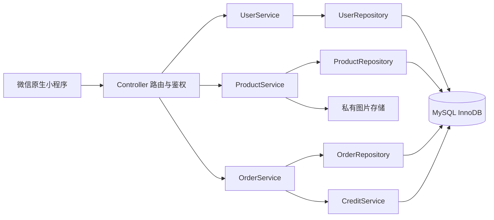
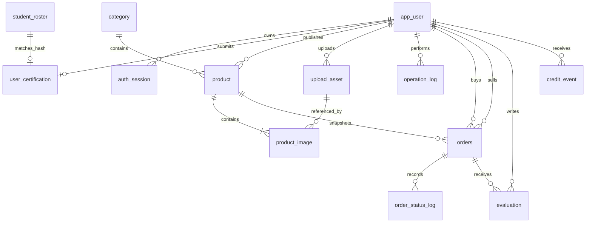
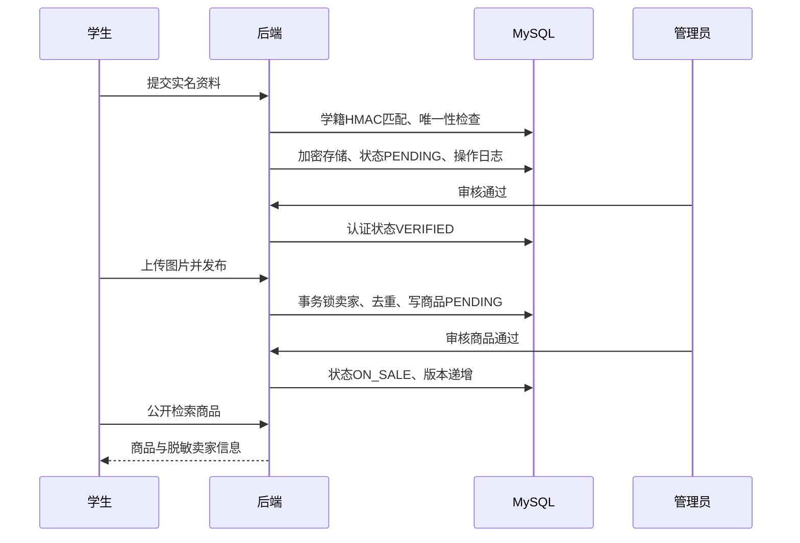

# 项目实现说明

## 与教材和交接材料的对应

需求资料确定业务范围；设计资料确定微信小程序、MySQL、三层结构和业务状态。统一项目按用户、商品、订单、评价信誉、咨询收藏和举报监管等业务模块组织。TypeScript Service/Repository 类负责对象封装和数据访问，Controller 负责鉴权、取参和响应。

## 数据关系

`student_roster` 与认证记录通过 HMAC 学号索引业务关联，不将明文学号用作外键。用户 `avatar_asset_id` 由服务端校验所有权。订单、状态日志、评价、信誉事件、聊天、收藏、举报和平台规则均已在当前数据库迁移中实现。

| 表 | 主要数据与约束 |
|---|---|
| app_user | bigint主键；openid哈希、演示账号分别唯一；role/status/certification_status；信誉0～100 |
| auth_session | 令牌SHA-256唯一；关联用户；7天有效；注销即删除 |
| student_roster | 学校+学号HMAC主键，姓名HMAC；仅虚构学籍 |
| user_certification | user_id与student_id_hash分别唯一；姓名、学号、电话AES-GCM加密；审核人及理由 |
| category | 分类名称唯一，active用于停用 |
| product | 外键卖家、分类；整数分价格；状态、版本、规范化标题及去重索引 |
| upload_asset/product_image | 上传归属与随机存储名；商品图片排序；发布前验证所有权 |
| operation_log | 操作者、业务动作、目标与非敏感元数据；不记录表单原文 |
| orders | 商品、买卖双方、标题和价格快照、状态、版本、幂等键及有效商品生成唯一键 |
| order_status_log | 订单状态动作、角色、请求编号和毫秒时间；唯一约束保证动作幂等 |
| evaluation | 订单双方各一次评价；公开查询不返回订单和身份内部字段 |
| credit_event | 完成、评价、举报和刷单的唯一计分事件；限制最终信誉0～100 |
| schema_migration | 迁移名称与SHA-256；已应用文件不可改写 |

## 审核与状态

认证：UNVERIFIED → PENDING → VERIFIED/REJECTED；REJECTED 可以重提。提交先匹配演示学籍，再进入人工审核；这不代表接入学校真实认证系统。学号不可被其他账号重复占用。重提和审核递增版本，管理员必须提交自己看到的expectedVersion，禁止旧列表批准新资料。商品审核同样检查版本。

商品初始 PENDING；审核 APPROVE → ON_SALE、REJECT → REJECTED。ON_SALE 可 TAKE_DOWN → OFF_SHELF；REJECTED/OFF_SHELF 可 SUBMIT → PENDING。编辑允许 PENDING/ON_SALE/REJECTED/OFF_SHELF，保存后均重审。LOCKED/SOLD/FROZEN 不允许卖家修改。

订单状态、动作角色、超时和退款释放规则详见[订单实现说明](orders.md)。下单在同一事务内锁定双方用户和商品，并把商品从 ON_SALE 条件更新为 LOCKED。客户端不能提交金额或目标状态；支付、交割、退款和裁决全部按动作表执行。

## 安全规则与已知边界

- AES-256-GCM使用每次随机IV和认证标签；学号唯一索引用独立HMAC密钥，原始身份不参与公开接口。更换加密密钥会使旧密文不可解密，需备份本地配置。
- 姓名保留首字，其余星号；11位电话前三后四；本人学号前四后两。短字符串全遮盖。公开卖家不返回学号。
- 上传仅接受PNG/JPEG/WebP，验证类型、文件签名和5MiB限制；不支持SVG/HTML。文件不按用户文件名存储。审核前仅本人/管理员读取，公开商品图片才可匿名读取，响应禁止缓存。
- 商品编辑、审核和上下架由后端动作表决定。卖家行锁保证同一卖家的去重和限流原子性，商品行锁串行化修改。下单事务复用相同行和版本机制，并通过有效订单唯一索引兜底。
- 24小时相同卖家、规范化标题、价格视为重复；每分钟最多成功发布5件；信誉低于60禁止发布。入口登录30次/分钟、实名10次/分钟、上传60次/分钟。
- 联系方式/违禁词检查是明确词表和模式匹配，存在同音字、图中文字等识别边界，需管理员审核，不能宣称自动鉴别所有虚假交易。
- 入口限流为单进程内存实现；发布限流与去重在数据库事务中。多实例生产部署应把入口限流迁到网关，增加存储配额、HTTPS及运维监控。

## 界面设计

按已确认的电商改版策略，购物操作主色采用深橙`#CF4710`、价格色`#DF4516`、浅灰底色`#F6F6F3`，认证与隐私标签保留绿色。系统中文字体保证开发工具与手机均可显示。首页压缩品牌介绍区，突出搜索、图标分类、摄影大图、成色和价格；“50元以内”“教材专区”“宿舍好物”均调用现有后端筛选，支持手动价格区间和清除条件，不展示虚构销量或优惠。

四件摄影素材保存在`assets/demo-products`并记录作者/来源/许可。新库seed使用这些照片，保留已有数据时不覆盖商品。详情突出图集、成色说明、卖家认证与脱敏信息，并提供下单、咨询、收藏、举报和公开评价入口；“我的”提供订单及互动记录入口。

`GET /api/health`以`demoLoginEnabled`和`wechatLoginEnabled`告知登录页可显示的方式。后者仅表示AppID/AppSecret均有配置，不代表微信平台联调已经通过；接口不返回密钥。课堂演示环境未配置平台密钥时隐藏不可用的微信登录按钮。

## 对交接材料的修正

1. 订单简版状态与详细设计不一致：以详细动作链为准，统一项目实现动作、超时、退款和纠纷裁决。
2. 已付款直接取消存在资金语义冲突：统一经过模拟退款后取消。
3. 数据库只有表名：实施阶段补齐各业务模块字段、唯一键、外键和版本索引。
4. 性能2秒/3秒表述不同：本地检索采用p95≤2秒目标，明确数据量与测试范围。
5. 原材料的“个人项目”措辞不适合小组：按业务模块协作，并通过PR交叉复核。
6. 顶层DFD中数据库被视为外部参与者不适合当前系统边界；本阶段用体系结构图和数据关系图明确数据库属于系统内部存储，未改写原DOCX。
