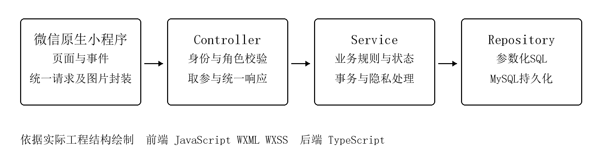
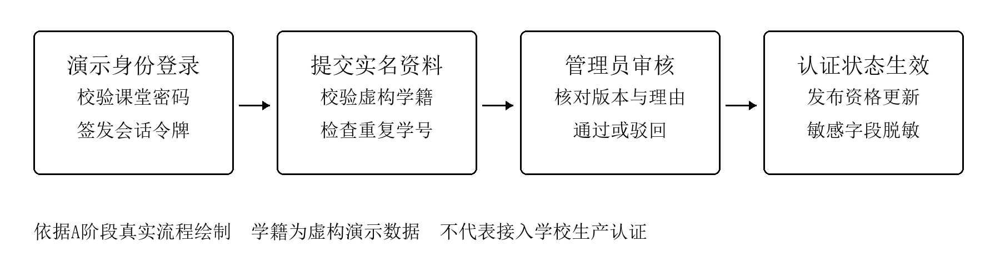
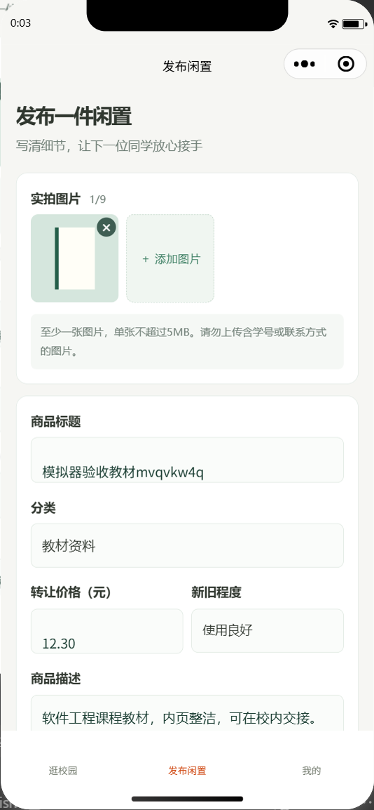
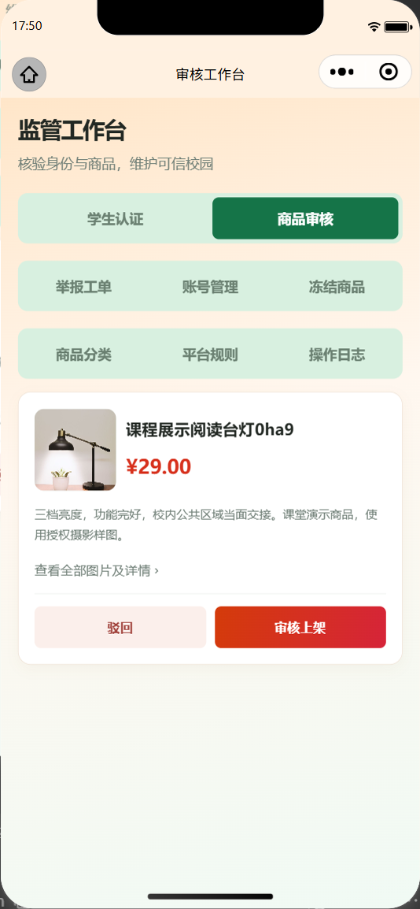
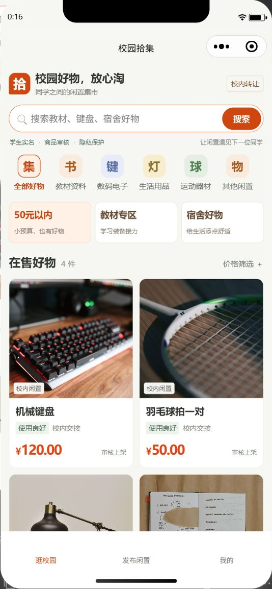
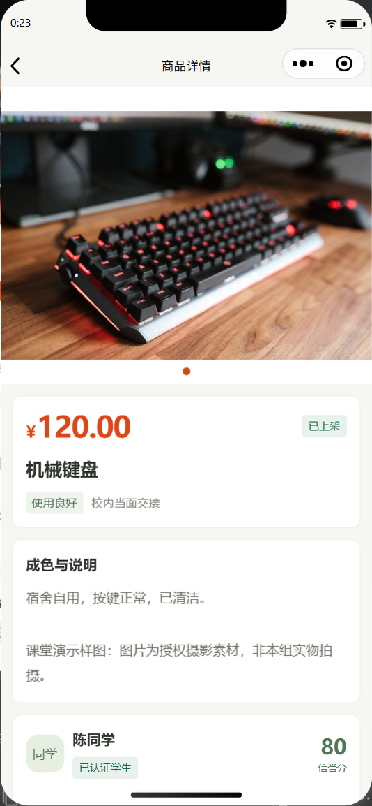

# 高校二手物品可信交易小程序软件实现报告

> 文档范围：本报告保留成员 A 基线交付时的实现与测试快照。成员 B 的订单、模拟支付、评价与信誉已完成，权威说明、状态图和最新证据见 [订单实现说明](../orders.md) 与 [项目测试记录](../test-report.md)。

## 一 实现目标与交付范围

本报告承接需求分析和软件设计，说明成员A如何将用户认证、商品发布检索、基础审核与隐私保护转化为可运行系统，并给出页面和测试证据。当前已完成独立演示闭环：登录、实名提交、管理员审核、商品发布、审核上架、检索详情、编辑重审及下架。

本报告采用增量交付记录。A 完成公共工程及用户和商品模块；B 现已在 `feature/orders-credit` 完成订单、模拟支付、评价与信誉；C 继续负责咨询、收藏、举报及监管整合。下文除特别注明外，保留 A 基线当时的实现与测试快照。

表3-1 成员A交付与后续模块边界

| 模块 | 本阶段结果 | 后续边界 |
|---|---|---|
| 公共工程 | 工程、便携环境、配置、迁移、接口和CI已提供 | A维护公共鉴权与错误处理 |
| 用户与认证 | 演示登录、微信登录代码路径、实名审核及脱敏 | 真实微信平台登录待AppSecret联调 |
| 商品与基础审核 | 上传、发布、审核、检索、编辑重审和上下架 | 交易锁定由B接入；统一监管由C整合 |
| 交易与评价 | A 基线冻结状态和信誉常量、事务及接口契约 | B 已完成业务、页面和专项测试，见[订单实现说明](../orders.md) |
| 咨询与监管 | 接口及模块边界已说明 | C实现业务、页面及专项测试 |

原需求分析和设计说明书保持原样。确认收货条件、模拟支付范围、隐私索引和三人分工等澄清另记在docs/changes.md；正文中的截图使用虚构数据与真实开发者工具结果。


## 二 运行环境与工程实现

小程序使用微信原生页面和事件机制，后端按Controller、Service、Repository分层。页面负责采集输入和展示状态；后端决定权限、所有权、状态流转及数据库写入，防止客户端直接修改业务结果。

表3-2 运行环境与组件

| 层次或组件 | 实际技术 | 主要作用 |
|---|---|---|
| 小程序 | JavaScript、WXML、WXSS | 8个页面及统一请求、媒体封装 |
| 服务端 | Node.js 24.19.0、TypeScript、Express 5 | HTTP接口、会话、业务规则及异常响应 |
| 数据库 | MySQL 8.4.13、InnoDB、mysql2 | 持久化、事务、行锁及索引；保持8.0兼容 |
| 开发工具 | 微信开发者工具2.02.2608080 | 基础库3.17.4；原生编译与模拟器验收 |
| 运行准备 | Windows PowerShell脚本 | 项目内Node/npm/MySQL、随机配置、健康检查 |



server/app.ts负责路由与鉴权；server/users和server/products分别提供Service与Repository。server/db集中连接池、迁移和事务工具，database/migrations保留已应用的不可变SQL。前端通过miniprogram/utils/api.js发送请求并下载有权限访问的图片。

统一响应为{code, message, data, requestId}，成功code为0；错误使用HTTP状态码及可理解提示。编号按字符串传输，金额以整数分存储和传输，列表默认每页20条。


## 三 登录与学生实名认证

### 3.1 会话与登录方式

课堂演示登录验证本机配置的共同密码，返回随机会话令牌；数据库仅保存令牌摘要，默认7天有效，退出时删除会话。请求封装通过Authorization头携带令牌，401时清理本地登录状态。过期令牌不阻断用户重新登录。

代码同时提供wx.login到服务端code2Session的可配置路径。健康接口返回demoLoginEnabled与wechatLoginEnabled，登录页据此显示可用方式；配置开关只表示有无平台参数，不表示外部联调已成功。当前AppID已设置，AppSecret未配置，课堂演示流程已验收。

### 3.2 学籍校验与审核

用户填写姓名、学号、手机号后，服务端先与虚构演示学籍匹配，检查学号是否已被占用，再加密保存并进入PENDING。管理员可通过或驳回，并记录理由；驳回后允许重新提交。未认证或被禁用用户无法发布商品。



审核列表返回version，提交审核时必须携带expectedVersion。服务端在事务和行锁内比较版本，陈旧列表返回409，避免管理员使用旧页面批准已修改资料。本人页面展示脱敏学号、姓名与手机号；公开卖家资料不返回学号。

未认证学生可浏览，发布接口会拒绝操作；已认证学生可管理自己的商品，管理员才可调用审核接口。资格和角色判断均在服务端执行，隐藏按钮只是页面引导。


## 四 商品发布与基础审核

发布页分组填写图片、标题、分类、价格、成色和描述。服务端要求标题2至50字、描述非空、价格为非负整数分、1至9张图片；单张不超过5MiB，类型与文件签名必须匹配。发布和图片上传都校验当前用户。





图片上传后先关联上传者，待审商品及图片仅本人和管理员可读；商品审核通过后才公开展示。管理员提交通过或驳回动作时也携带expectedVersion，陈旧审核返回409，操作日志仅记录必要的非敏感元数据。

发布、编辑、重新提交均由服务端决定目标状态。已审核商品被编辑后重新进入待审，防止审核后替换内容；LOCKED、SOLD、FROZEN商品禁止卖家直接修改。下架后公开列表及匿名媒体访问随可见性规则收回。


## 五 商品检索与详情展示

首页以摄影商品卡片突出图片、价格和成色，分类图标与快捷导购复用真实商品列表接口。“50元以内”设置最高5000分；教材与宿舍专区依据分类接口返回的编号筛选，切换入口时清除旧条件，支持关键词、手动价格及空结果恢复。





详情页展示图片、价格、成色说明、卖家认证与信誉，姓名和手机号按规则脱敏，学号不公开。当前四件商品采用有来源记录的授权摄影素材，并在描述中标注课堂演示样图；不声称是本组真实待售物品的实拍。

新机器初始化会复制仓库内四张JPEG，不依赖临时外链；再次seed不覆盖已有商品。搜索请求保留序号判断，较早请求的返回结果不能覆盖较新的筛选结果。A 基线截图未添加购买入口；B 当前已接入下单、订单和评价页面，聊天与举报仍由 C 实现。


## 六 隐私保护与异常拦截

### 6.1 敏感数据与访问控制

姓名、学号、手机号使用AES-256-GCM加密，每次使用随机IV及认证标签；学号以独立密钥计算HMAC索引进行唯一性校验。密钥保存在本机配置，代码库只包含模板。公开接口采用白名单输出字段，操作日志不记录敏感原文。

表3-3 隐私与异常防护对应

| 风险 | 已实现措施 | 主要代码 |
|---|---|---|
| 身份泄露 | 加密存储、姓名和电话脱敏、公开卖家不含学号 | server/common/privacy.ts<br>server/users/service.ts |
| 越权操作 | 会话、角色、所有权和状态均在后端检查 | server/app.ts<br>server/products/service.ts |
| 伪装图片 | 限制PNG/JPEG/WebP，核对签名与体积 | server/products/rules.ts |
| 重复发布 | 规范化标题与价格检查，卖家行锁串行化 | server/products/service.ts |
| 恶意内容及高频 | 联系方式/违禁词规则，成功发布5件/分钟 | 商品规则与Service |
| 状态绕过 | 动作表、审核版本、编辑后重审 | 商品规则与审核事务 |

### 6.2 重复发布与并发处理

同一卖家24小时内规范化标题相同且价格相同，视为重复发布。若只先查再写，两个并发请求可能都查到不存在。当前实现先锁定卖家行，在同一事务中完成去重、频率和信誉检查，再写商品、图片关联及日志，失败统一回滚。

```text
处理步骤  按真实实现概括
开始事务 → 锁定卖家行 → 检查资格与频率
检查24小时重复标题及价格 → 写入待审商品与图片关联
写入非敏感日志 → 提交；任一步失败则回滚
```

信誉低于60禁止发布。联系方式检查采用词表和模式匹配，无法识别全部同音字或图中文字，仍需人工审核。订单完成、评价和刷单信誉事件现由 B 的唯一信誉服务处理。


## 七 测试与实际运行结果

测试依据需求编号及风险场景组织，既检查正常业务，也覆盖失败分支。自动化单元和页面行为测试使用Node内置测试框架；集成与性能测试使用独立真实MySQL测试库，避免清空演示数据。

表3-4 自动化与性能验证结果

| 检查项目 | 实际结果 | 说明 |
|---|---|---|
| 类型与构建 | 通过 | TypeScript、8页静态与20操作契约 |
| 官方原生编译 | 通过 | 8个WXML、9个WXSS |
| 单元及页面逻辑 | 13项通过 | 脱敏、加密、状态、金额、请求、草稿与筛选 |
| MySQL集成 | 9组通过 | 认证、商品、并发、权限、图片及初始化 |
| 原生模拟器 | 十步通过 | 未处理异常0，脚本退出0 |
| 100并发检索 | 100/100成功 | 212件样本，本机HTTP及连接池20 |
| 响应时间 | p50 101.14ms<br>p95 110.95ms<br>最大113.94ms | 本机目标p95≤2000ms，通过 |
| GitHub CI | c16e38e作业成功 | 类型、构建、单元、MySQL和性能 |

白盒覆盖范围为errors.ts、privacy.ts、contracts.ts和products/rules.ts：行100%、分支97.87%、函数100%。该覆盖率只针对列出的核心文件，不是整个后端。并发发布测试确认两个相同请求仅成功一次且无孤立商品。

安全专项验证了修改他人商品、普通用户调用审核接口、学号重复、伪造图片归属、SQL注入参数、锁定商品修改和敏感字段泄露。测量结果仅代表本机当前样本的接口表现，不等同于100名真机用户的校园生产负载。

原生验收仅为相册系统选择器提供虚构图片回调，后续图片读取、上传和业务接口使用真实实现。真实设备相册、断网恢复及微信平台登录单独待联调，不能以自动化通过代替。详细记录见docs/test-report.md。


## 八 部署运行与小组交接

### 8.1 新电脑启动

在项目根目录执行准备和启动脚本。.tools保存便携工具，.runtime保存数据库、图片和日志；setup随机生成本地配置并保留旧数据，专用ASCII路径入口兼容中文目录。

```text
powershell -ExecutionPolicy Bypass -File .\scripts\setup.ps1
powershell -ExecutionPolicy Bypass -File .\scripts\start.ps1
健康检查  http://127.0.0.1:3000/api/health
```

开发者工具导入miniprogram目录，按README配置接口地址。密码从本机.env读取，不投屏完整配置。真机联调需换成可访问的服务地址，不能直接访问电脑的127.0.0.1。

表3-5 课堂演示身份

| 演示身份 | 初始状态 | 用途 |
|---|---|---|
| seller 陈同学 | 已认证 | 发布、编辑和下架商品 |
| buyer 周同学 | 已认证 | 浏览及越权拦截 |
| newstudent 林同学 | 未认证 | 完整实名提交与审核 |
| admin 平台管理员 | 管理员 | 实名及商品审核 |

### 8.2 后续模块接入

B 已在feature/orders-credit完成订单、模拟支付、状态机、退款纠纷、评价和信誉事件；C从feature/chat-reports接入咨询、收藏、举报及监管工作台。C复用A的审核接口并保留expectedVersion，举报扣分通过B的唯一事件服务执行，不直接修改信誉分。

当前完整增量在feature/interface-polish，PR #1经另一成员复核后合入main。CONTRIBUTING.md、docs/tasks.md和docs/handoff已说明分支、任务、迁移及接口。代码快照为member-a-20261028，本报告作为后续文档增量提交。

仓库只提交源码、虚构数据、配置模板和授权素材。各成员提交页面、接口、迁移和测试，CI通过并经同伴复核后合入。


## 附录 课堂展示与PPT素材索引

建议用6至8分钟展示A的增量，以实际闭环与测试证据为主。下表中的PNG/JPEG均独立保存在ppt-assets，可直接插入PPT；保留原图比例，避免将竖屏截图拉宽。图号与本报告一致。

表3-6 PPT素材与讲解安排

| PPT页 | 主题与素材 | 讲解重点 |
|---|---|---|
| 1 | 实现范围及分工<br>本报告第一节 | 先说明A已完成和B/C接入边界 |
| 2 | 05-architecture.png<br>图3-1 | 页面展示，Service管规则，Repository持久化 |
| 3 | 06-certification-flow.png<br>图3-2 | 学籍演示、人工审核、版本与脱敏 |
| 4 | 03-publish.png、04-review.png<br>图3-3 | 发布待审、审核上架、编辑重审 |
| 5 | 01-home.jpg、02-detail.png<br>图3-4 | 真实筛选、摄影样图、价格成色与卖家脱敏 |
| 6 | 本报告测试结果表<br>docs/test-report.md | 13项、9组、十步；100并发p95及其范围 |

演示口径示例：我们先把公共工程、认证和商品流程做成可独立运行的增量。客户端只提交业务动作，后端统一检查角色、所有权、状态和版本。身份字段加密保存并脱敏返回；重复发布在事务内锁定卖家进行检查。当前测试和原生流程已通过，订单与监管扩展按冻结接口交给另外两位成员。

截图来源说明：首页与摄影详情来自恢复后的演示库；发布与审核截图来自真实模拟器隔离测试库，标题含自动化验收标记，图片为确定的虚构测试封面。两类截图均是实际运行结果。素材目录附逐图来源、验证时间和可讲述结论，不能把演示样图说成真实在售实物。

依据：原需求分析、设计说明书，以及仓库实现、接口、测试和截图。代码基线c16e38e，本次补充报告和素材。原始交接DOCX保持原样。
