# 高校二手物品可信交易小程序软件实现报告

更新日期：2026年10月31日。本文记录统一 `main` 项目的功能实现、验证与课堂展示素材。

---

《软件工程基础》课程设计

第三部分：统一项目实现、测试与展示素材

实施组

2026年10月31日

## 一、实现范围与工程结构

本报告对应仓库默认分支 main 上的统一项目。小程序采用微信原生技术；服务端按 Controller、Service、Repository 分层，业务按用户认证、商品、订单、评价信誉、咨询收藏、举报监管等职责组织。页面负责展示和提交动作，后端负责权限、状态、事务和持久化。

表3-1 运行组件与职责

| 层次 | 技术与实现 | 职责 |
|---|---|---|

| 客户端 | 微信原生小程序：WXML、WXSS、JavaScript | 页面、表单、导航、请求和图片展示 |

| 服务端 | Node.js 24、TypeScript、Express 5 | 会话、参数校验、业务规则、统一错误响应 |

| 业务与数据 | 模块化 Service/Repository、MySQL 8.4 / 8.0兼容 | 事务、行锁、索引、迁移与状态一致性 |

| 统一契约 | /api、OpenAPI、requestId、整数分金额 | 统一请求响应、权限边界与协作接入 |

图3-1 统一系统分层与业务模块

数据库迁移按编号追加，不修改已经应用的迁移。接口统一返回 {code, message, data, requestId}；客户端传递业务动作，服务端只接受状态机允许的动作。公开数据采用字段白名单，编号按字符串传输，金额按整数分保存。

## 二、登录、实名认证与隐私保护

课堂演示使用本地演示身份和虚构学籍名单；实名资料提交后进入审核队列，管理员通过或驳回并记录理由。只有认证有效且账号正常的学生可以发布商品和创建订单。会话令牌只保存摘要，用户退出后服务端撤销会话。

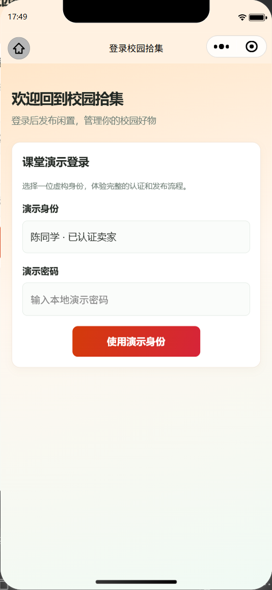  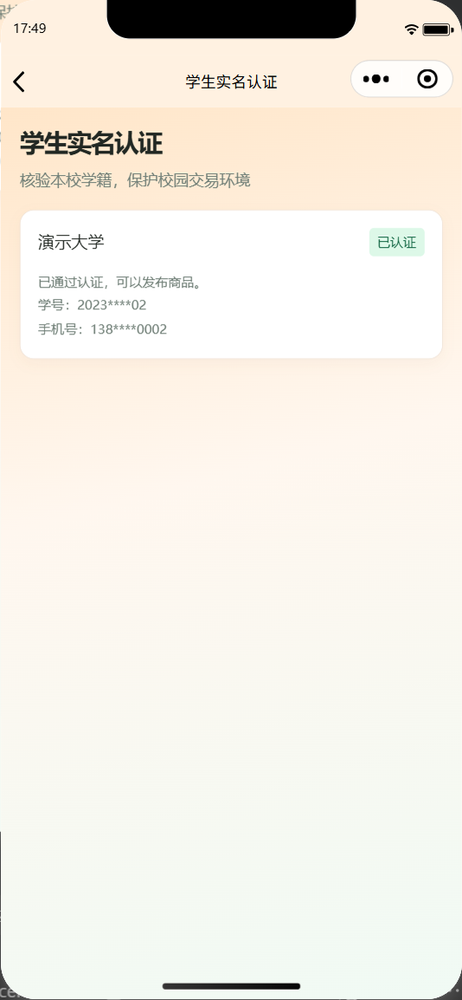

图3-2 演示登录入口与认证结果

图3-3 认证、人工审核与发布资格流程

姓名、学号和手机号采用 AES-256-GCM 加密保存；学号使用独立 HMAC 索引检查重复。个人页面展示脱敏字段，公开卖家资料不返回学号。真实微信 wx.login 路径已留出配置接口，但当前没有 AppSecret，因此平台身份联调未验收。

## 三、商品发布、审核与检索

发布端支持图片上传、标题、分类、价格、成色和描述。服务端检查标题长度、非空描述、非负整数分价格、图片数量、图片大小和文件签名；商品先进入待审，审核通过后才公开。编辑已审核商品会重新进入审核，锁定或售出的商品不能由卖家直接改写交易信息。

  

图3-4 商品发布表单与待审商品队列

首页支持分类、关键词和价格筛选；详情展示商品实图、价格、成色、认证及信誉信息。“我的商品”提供编辑和上下架入口。重复发布按规范化标题、价格和24小时窗口判断，并在卖家行锁事务内执行，避免并发请求同时通过。

  

图3-5 首页商品卡片与商品详情

配图中的商品身份和交易均为课堂虚构演示数据；商品摄影样图来自仓库注明的授权素材，不代表本组实际在售物品的实拍。

## 四、个人资料与商品管理

个人中心集中显示认证状态、信誉分、我的商品、订单、咨询、收藏、举报记录和管理入口。卖家商品列表展示审核、在售、下架、冻结及售出等业务状态；页面按钮只提供交互提示，最终权限和状态仍由后端复核。

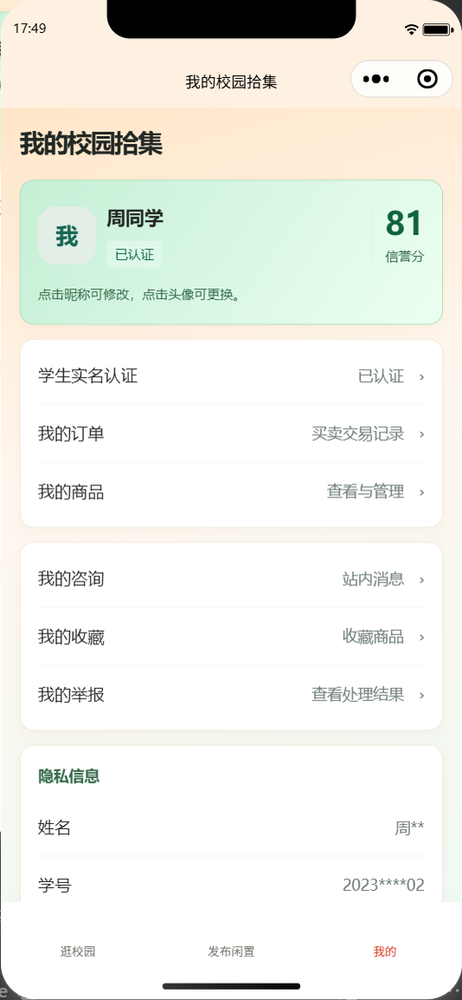  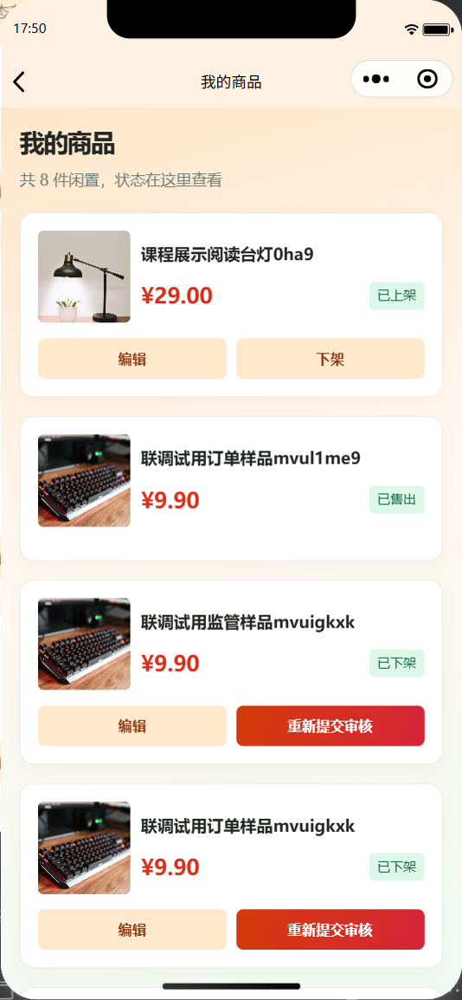

图3-6 个人中心与本人商品管理

商品编辑和下架接口进行所有权检查；普通用户无法调用管理员审核接口。审核操作带版本号，过期页面提交时返回冲突，避免使用旧列表覆盖新状态。

## 五、订单状态机与模拟担保

下单时服务端读取数据库中的商品价格快照，不接受客户端传入的金额；在同一事务中检查买卖双方资格、锁定商品、创建订单并记录状态日志。条件更新、商品锁和有效订单唯一约束共同防止同一商品产生多笔有效订单。重复请求使用请求编号保持幂等。

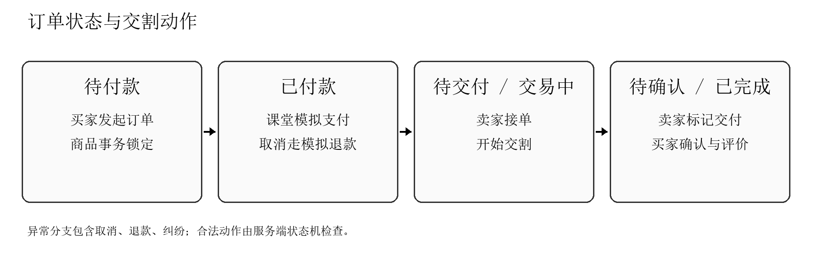

图3-7 从下单到交割、确认和评价的状态流程

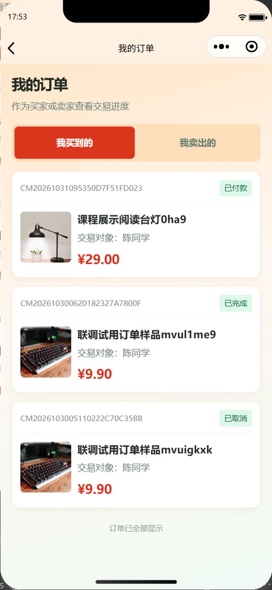  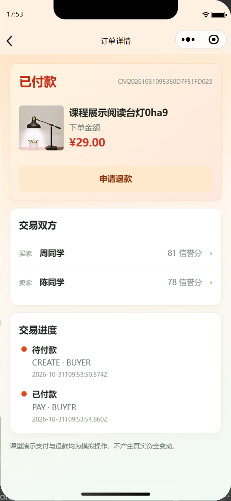

图3-8 订单列表与模拟支付后的订单详情

状态动作依次包括待付款、已付款、待交付、交易中、待确认、已完成；取消、退款和纠纷由独立动作分支处理。待付款订单超过15分钟会释放，已付款超过24小时未接单则进入退款流程；每次超时扫描最多处理50笔候选订单。退款完成前商品保持锁定，冻结商品或禁用卖家不会被退款恢复逻辑覆盖。支付和退款均为课堂模拟，不接入真实资金渠道。

## 六、交割、评价与信誉

卖家接单后可开始交割并标记已交付，买家确认后订单完成。完成订单后，双方各自最多提交一次评价。公开评价接口只返回公开评价内容，不返回订单号和内部身份字段。

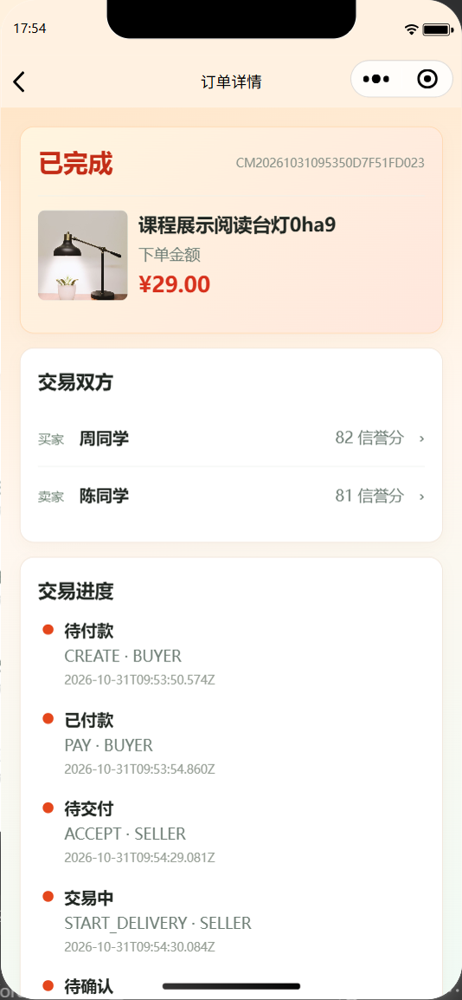  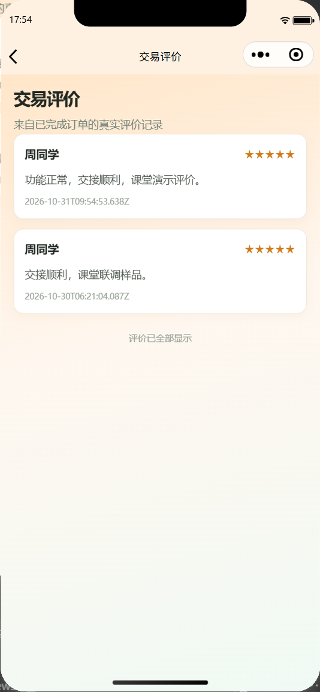

图3-9 完成订单与公开交易评价

表3-2 信誉事件规则

| 事件 | 分值变化 | 幂等约束 |
|---|---|---|

| 初始分 | 80；总分限制在0至100 | 数据库用户记录 |

| 订单完成 | 买卖双方各 +1 | 按订单和用户建立唯一事件 |

| 评价星级 | 五星 +2、四星 +1、三星 0、二星 -1、一星 -3 | 同一订单每人只能评价一次 |

| 成立举报 / 刷单 | -5 / -10 | 信誉事件唯一键阻止重复计分 |

## 七、站内咨询与收藏

买家和卖家可围绕具体商品进行站内咨询；会话只允许参与双方读取和发送消息，发送请求携带客户端消息编号以支持重试幂等。收藏与取消收藏采用幂等接口；商品失效后保留收藏记录并显示当前可用状态。

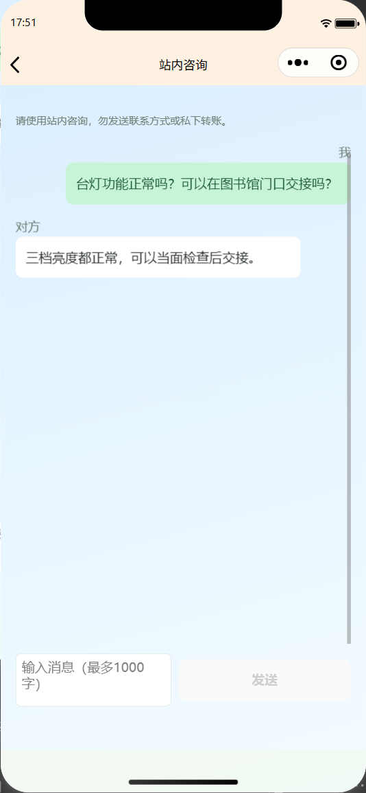  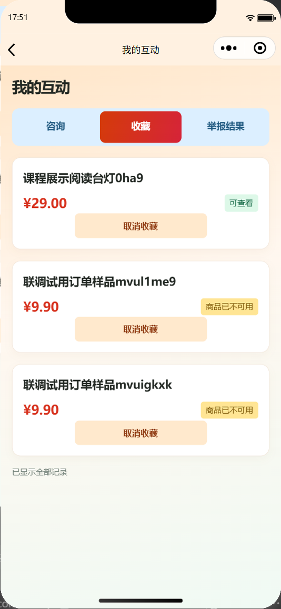

图3-10 真实双向咨询与个人收藏列表

消息及收藏使用当前登录身份完成鉴权；管理员或无关用户不能读取他人的私密会话。页面离开后停止增量刷新，避免后台继续轮询。

## 八、举报处理与统一监管

举报表单要求填写对象、原因和说明；后端检查目标权限并阻止重复的待处理举报。用户只能查看本人举报及处理结果。管理员工作台集中处理学籍、商品审核、举报、商品冻结、账号状态和平台规则。成立举报后，处置与信誉事件在事务中写入，关键操作记录理由。

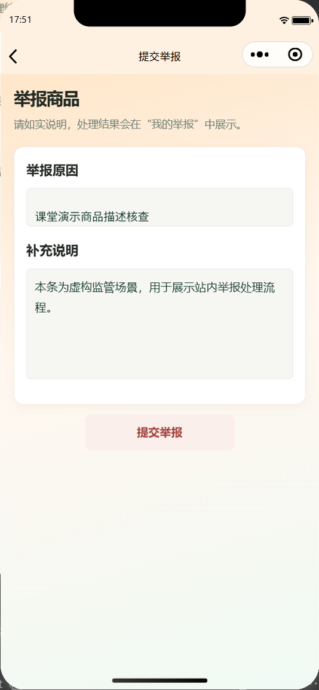  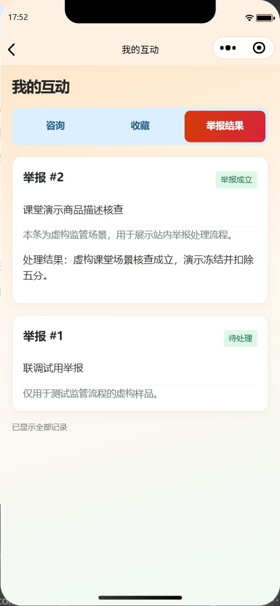

图3-11 举报提交表单与本人处理结果

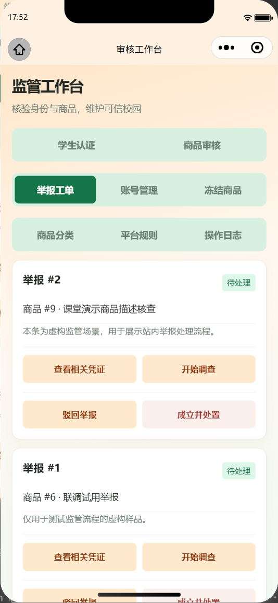  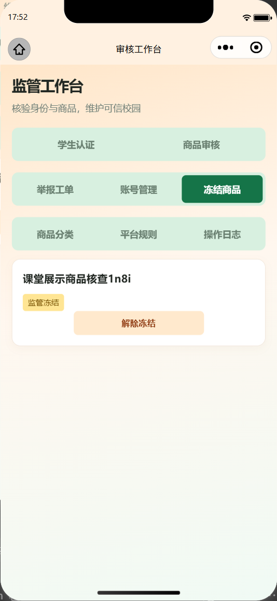

图3-12 管理员举报工单与商品冻结状态

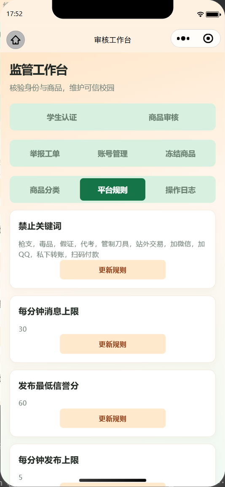  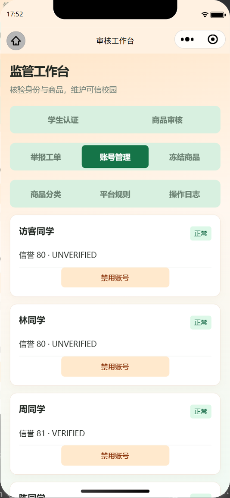

图3-13 平台规则管理与账号信誉管理

监管状态与订单锁定分开记录；解除冻结不会自动将商品重新上架，也不会绕过订单状态机。管理员动作在服务端执行角色和状态校验，普通账号调用监管接口会被拒绝。

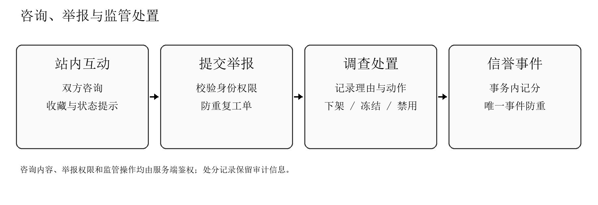

图3-14 举报、监管处置与信誉事件的统一事务

## 九、隐私、安全与异常拦截

表3-3 安全风险与实现措施

| 风险 | 实现措施 | 验证重点 |
|---|---|---|

| 敏感信息泄露 | AES-GCM加密、学号HMAC索引、姓名电话脱敏、公开字段白名单 | 密文存储、篡改拒绝、公开响应不含学号 |

| 越权操作 | 服务端角色、所有权、身份和状态校验 | 修改他人商品、普通用户审核及他人举报读取 |

| 并发重复 | 卖家行锁、订单条件更新、唯一业务事件 | 重复发布、并发下单、重复评价与扣分 |

| 恶意输入 | 参数化SQL、图片签名/大小校验、词表规则和频率限制 | SQL注入、非法编号、超限图片与刷频 |

| 状态绕过 | 订单状态机、审核版本、编辑后重新审核 | 非法状态动作、陈旧版本、冻结退款覆盖 |

关键操作日志只记录必要的非敏感元数据，不存储密码、令牌和敏感身份原文。联系方式及违禁词匹配属于规则筛查，不能替代人工审核，也无法识别图片内文字或全部变体。

## 十、测试与运行验证

项目已有的自动化证据覆盖类型检查、构建、接口契约、页面行为和真实 MySQL 集成。合并到统一 main 后，最近一次验证记录为：14 个小程序页面静态检查、50 个 OpenAPI 操作契约、27 项单元/页面测试、36 组 MySQL 集成测试；官方原生编译覆盖14份 WXML 和15份 WXSS。100并发公开检索在本机测试库中100/100成功，既有p95为110.95ms（212件样本），不代表真实校园生产容量。

表3-4 测试证据及范围

| 测试层次 | 记录结果 | 说明 |
|---|---|---|

| 静态与契约 | 14页检查；50项OpenAPI操作 | 检查页面、路由、请求和接口Schema对应 |

| 单元与页面逻辑 | 27项通过 | 涵盖权限辅助、隐私、状态与交互行为 |

| MySQL集成 | 36组通过 | 独立测试库，覆盖事务、并发、权限和迁移 |

| 原生编译 | 14份WXML、15份WXSS通过 | 微信开发者工具基础库3.17.4 |

| 端到端截图流程 | 20张模拟器原始截图，14个页面路由 | 包含举报、监管和真实订单状态 |

| 并发性能 | 100/100成功；p95 110.95ms | 212件本机测试样本；仅作课堂基线 |

20张界面图片通过微信开发者工具官方 simulator_screenshot 命令生成；演示数据均为虚构。对图片选择的课堂流程使用授权摄影文件作为本地离线选择回调，上传及商品流程调用真实本机服务。没有用示意图冒充页面截图。

## 十一、课堂演示流程与已知边界

表3-5 建议课堂演示顺序

| 顺序 | 页面操作 | 可说明的工程要点 |
|---|---|---|

| 1 | 登录并查看认证状态 | 演示身份、学籍审核、脱敏展示 |

| 2 | 发布商品并由管理员审核 | 上传限制、待审不可见、版本冲突处理 |

| 3 | 搜索商品并查看详情 | 分类/关键词/价格筛选、卖家隐私 |

| 4 | 发起订单并模拟付款 | 服务端价格快照、事务锁定与幂等 |

| 5 | 卖家交割、买家确认和评价 | 状态机、角色权限、唯一信誉事件 |

| 6 | 咨询、收藏并提交举报 | 参与者隔离、本人记录访问 |

| 7 | 管理员调查并处置举报 | 冻结、信誉事件、监管工作台 |

运行边界：演示学籍名单为虚构数据；支付与退款为模拟动作；真实微信平台登录需配置AppSecret并单独验证；真机相册、网络波动和线上部署未纳入本次本机模拟器截图验收。

界面中的摄影商品图片保留原色；报告正文、表格、标题、页眉和页码统一黑色宋体。正文12磅、1.5倍行距，A4纵向、四边约2.5厘米。

## 十二、PPT图片索引与讲解提纲

随报告提供24项独立素材：20张原生模拟器页面截图和4张依据实现绘制的流程图。PPT可围绕“认证与发布、订单闭环、咨询监管、测试证据”组织，不需要按成员拆分章节。所有截图来源、页面路由、身份、日期、原图状态和SHA-256均登记在素材清单。

表3-6 推荐展示素材

| 讲解段落 | 素材 | 建议表达 |
|---|---|---|

| 首页与商品 | 01-home、02-detail、03-publish、04-review | 从检索与详情进入发布审核闭环 |

| 认证与隐私 | 10-login、11-certification、06-certification-flow | 演示校验、审核和脱敏规则 |

| 订单与信誉 | 07-order-flow、13-orders、14-order-paid、15-order-completed、16-evaluations | 展示服务端状态机、模拟支付与评价 |

| 咨询与监管 | 17-chat、18-favorites、19-report、20-reports、21-moderation、22-frozen | 展示参与者隔离和违规处理 |

| 平台运行 | 05-architecture、23-rules、24-users | 说明分层、参数配置和信誉监管 |

图像文件可直接用于课堂PPT，保持原比例，不裁掉状态栏、状态文字或敏感字段说明。素材来源说明见 `ppt-assets/README.md` 与 `ppt-assets/provenance.json`；项目商品摄影许可说明见 `assets/demo-products/README.md`。
