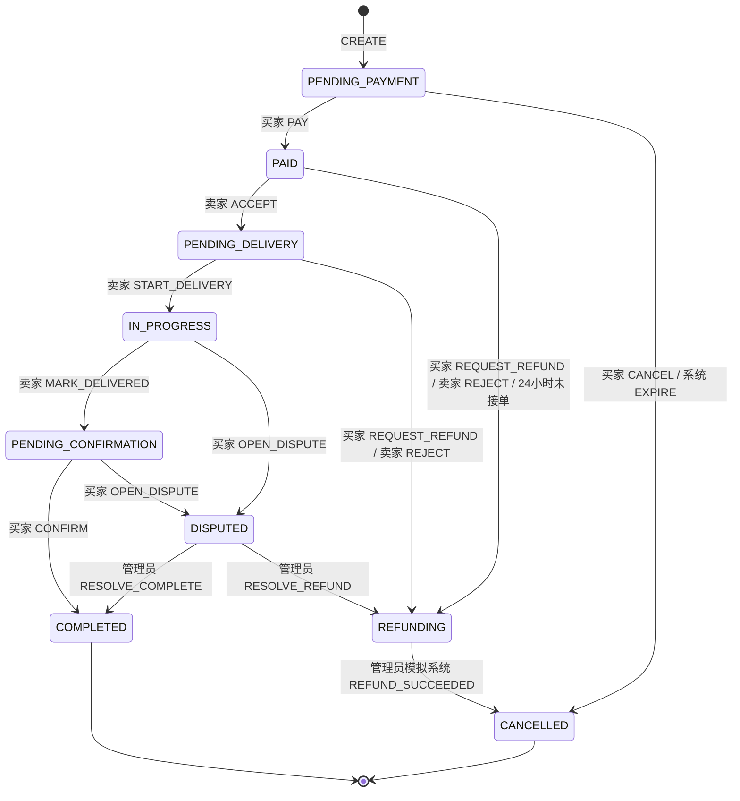
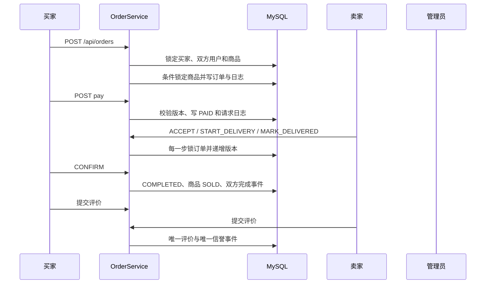

# 订单、评价与信誉模块实现说明

本说明记录统一项目 `main` 中的订单、模拟支付、状态流转、超时、退款、纠纷裁决、双向评价和信誉事件实现。课堂报告已将本内容合并到[第三部分软件实现报告](implementation-report/README.md)；此页保留较详细的事务与接口参考。

## 交付范围

订单模块包含页面、真实 MySQL 事务、OpenAPI、测试与课堂演示材料。

## 数据库迁移

迁移文件为 `database/migrations/003_b_orders.sql`，新增四张表：

| 表 | 作用 | 关键约束 |
|---|---|---|
| `orders` | 订单主记录、价格与标题快照、版本 | 买家请求幂等唯一；有效商品唯一 |
| `order_status_log` | 状态、动作、操作者角色和请求日志 | `(order_id,request_id)` 唯一 |
| `evaluation` | 交易双方评价 | `(order_id,reviewer_id)` 唯一 |
| `credit_event` | 信誉变化唯一业务事件 | `(event_type,source_id,user_id)` 唯一 |

`orders.active_product_id` 是由状态生成的存储列。处于待付款、已付款、待交付、交易中、待确认、纠纷或退款中的订单占用商品；完成和取消后该列为 `NULL`。唯一索引使并发请求即使绕过应用层检查，也只能有一笔有效订单。

迁移一旦应用不得修改。后续字段变化应新增 `004_b_*.sql`，并在应用前备份本地数据。

## 事务边界

下单事务按以下顺序执行：

1. 锁定买家行，按买家请求编号检查幂等。
2. 读取商品卖家，再按用户编号固定顺序锁定买卖双方。
3. 检查双方账号启用和实名状态，拒绝自购。
4. 锁定商品行，重新读取标题、价格、状态和版本。
5. 条件更新 `ON_SALE -> LOCKED` 并递增商品版本。
6. 写入订单、初始状态日志和操作日志。

客户端不提交金额。即使附带 `amountCents`，服务端仍使用数据库中的整数分价格。

订单动作事务先锁订单，再检查请求幂等、提供版本、操作者角色和当前状态，最后递增订单版本。支付、接单、交割、确认、退款和裁决不能通过任意 `status` 字段修改。

## 状态机

权威动作表位于 `server/contracts.ts` 的 `ORDER_TRANSITIONS`。





## 超时与商品恢复

- 待付款超过 15 分钟：系统动作 `EXPIRE` 转为 `CANCELLED`。
- 已付款超过 24 小时仍为 `PAID`：系统发起退款并进入 `REFUNDING`。
- 超时扫描在订单列表、详情和下单前执行，每次最多处理 50 笔候选订单。
- 未付款取消或退款成功后，只有商品仍为 `LOCKED`、卖家仍启用且实名有效时才恢复 `ON_SALE`。
- 商品为 `FROZEN`、卖家禁用或商品状态已被其他业务修改时，订单取消不覆盖现状。

## 评价与信誉

订单完成后，买卖双方各评价对方一次。星级范围为 1～5，正文可选且最多 500 字。公开评价接口不返回订单号、卖家或买家内部身份字段。

信誉规则：

| 事件 | 分值 |
|---|---:|
| 完成订单 | 买卖双方各 `+1` |
| 五星评价 | `+2` |
| 四星评价 | `+1` |
| 三星评价 | `0` |
| 二星评价 | `-1` |
| 一星评价 | `-3` |
| 成立举报 | `-5` |
| 刷单 | `-10` |

初始 80，范围 0～100。举报监管服务通过同一事务连接调用：

```ts
await creditService.applyEvent(db, {
  userId,
  eventType: 'REPORT',
  sourceId: reportId,
  delta: -5
});
```

重复事件返回 `applied=false`，不重复更新。

## API

| 方法与路径 | 权限 |
|---|---|
| `POST /api/orders` | 已认证且实名的学生买家 |
| `GET /api/orders?side=buyer\|seller&page=1` | 当前用户参与订单 |
| `GET /api/orders/{orderNo}` | 订单双方或管理员 |
| `POST /api/orders/{orderNo}/pay` | 买家，待付款 |
| `PUT /api/orders/{orderNo}/status` | 状态机对应角色；管理员只执行裁决动作 |
| `POST /api/orders/{orderNo}/confirm` | 买家，待确认 |
| `POST /api/orders/{orderNo}/evaluations` | 已完成订单双方 |
| `GET /api/users/{id}/evaluations` | 公开 |

## 页面入口

- 商品详情：可售非本人商品显示“立即下单”。
- 我的页面：“我的订单”进入买家/卖家订单列表。
- 订单详情：展示金额快照、双方资料、状态历史和仅由服务端返回的允许动作。
- 订单图片：买家可读取本人参与订单的商品缩略图；未参与用户仍无法访问锁定商品媒体。
- 完成订单：显示评价表单。
- 卖家详情与公开评价页：展示评价星级、正文和日期。

## 验证

```powershell
.\scripts\npm.ps1 run check
.\scripts\npm.ps1 test
.\scripts\npm.ps1 run test:integration
.\scripts\npm.ps1 run build
```

专项覆盖并发下单、自购、未认证、角色越权、陈旧版本、请求幂等、重复支付/退款、超时、冻结绕过、禁用卖家、重复评价和信誉边界。
