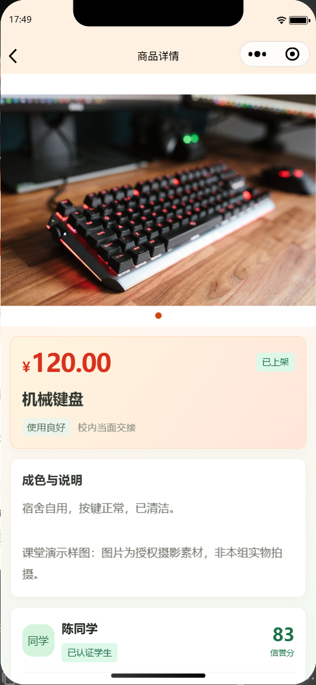

# 校园拾集界面风格与截图

首页以橙红建立购物氛围，黄、蓝、绿分别用于低价入口、教材和宿舍分类、认证信誉。商品图片与白色卡片保持清晰，价格和交易动作突出显示；个人与监管页面使用校园绿色，咨询页用浅蓝区分双方消息。

所有截图均为统一项目在本机微信开发者工具中的真实模拟器页面，使用虚构演示身份和授权摄影样图。以下图片已同步为2026年10月31日截图：

### 首页

### 商品详情

### 个人中心

20张页面截图和四张代码流程说明图见[课堂展示素材目录](implementation-report/ppt-assets/README.md)。摄影图是获授权演示样图，不是小组实际销售商品的实拍。配色没有增加虚构销量、折扣或倒计时数据。
