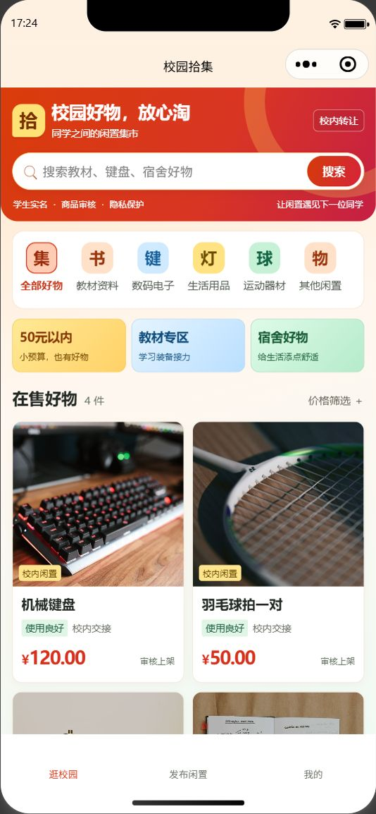
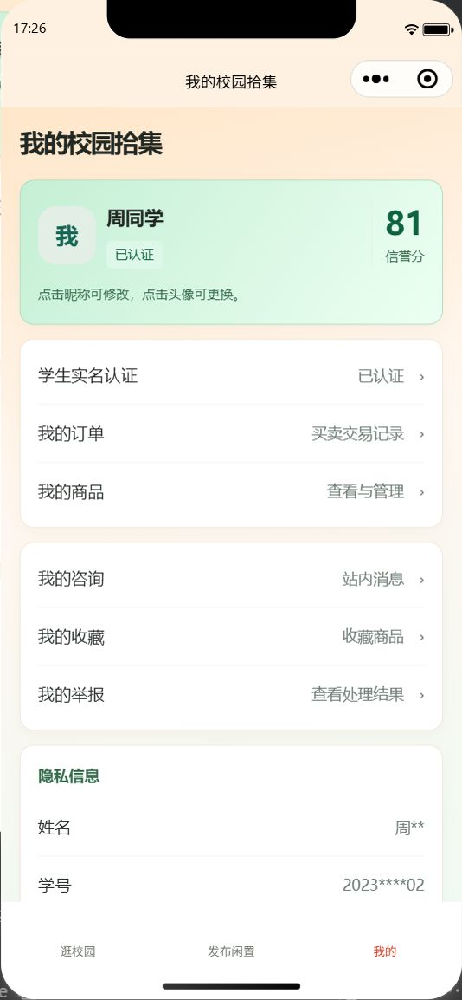

# 校园拾集界面配色

2026-10-31，完整代码位于 `codex/try-bc`。按小组提出的电商色彩方向，首页以橙红带出购物氛围，黄、蓝、绿区分低价、教材和宿舍入口，真实商品图片搭配黑字白卡。

| 区域 | 配色与作用 |
|---|---|
| 首页、搜索和主要按钮 | 橙红，突出品牌、搜索和交易动作 |
| 50元以内 | 黄色，识别小预算入口 |
| 教材专区 | 蓝色，识别学习用品入口 |
| 宿舍好物、认证及信誉 | 校园绿，识别生活用品与认证信息 |
| 商品详情、订单概览 | 浅橙与暖黄底，突出价格与状态 |
| 个人页、监管页 | 绿色身份卡和选中状态 |
| 咨询 | 浅蓝背景与绿色本人消息气泡 |

这是现有页面的视觉调整，商品、价格、审核、交易和权限规则沿用已接入实现，没有增加虚构销量、折扣或倒计时。

## 真实界面

截图来自本机微信开发者工具，使用虚构演示身份和授权摄影样图；不是设计稿。以前的实现报告截图保留原验收版本，本次截图单独提供给小组制作PPT。

### 首页

### 商品详情

### 我的

## 验证

- 类型、14页静态检查、50个OpenAPI操作契约一致性通过。
- 官方编译器通过14个WXML和15个WXSS，27项现有单元/页面测试通过。
- 已查看首页、商品详情和个人页的模拟器截图，收紧分类区空白并固定头像尺寸；标题、价格、筛选及登录入口保留。
- 手机预览/体验版、微信平台真实登录和正式发布仍属后续工作。GitHub上的代码及图片不等同于已经发布可搜索的小程序。
